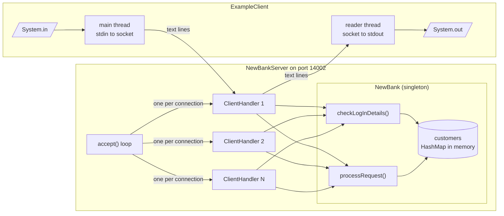
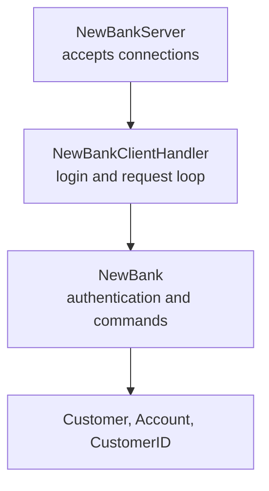
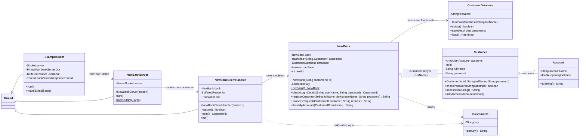
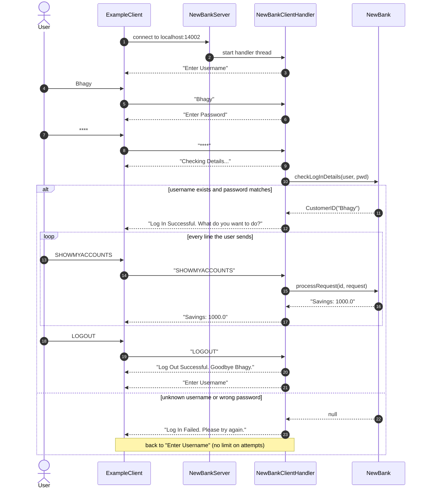
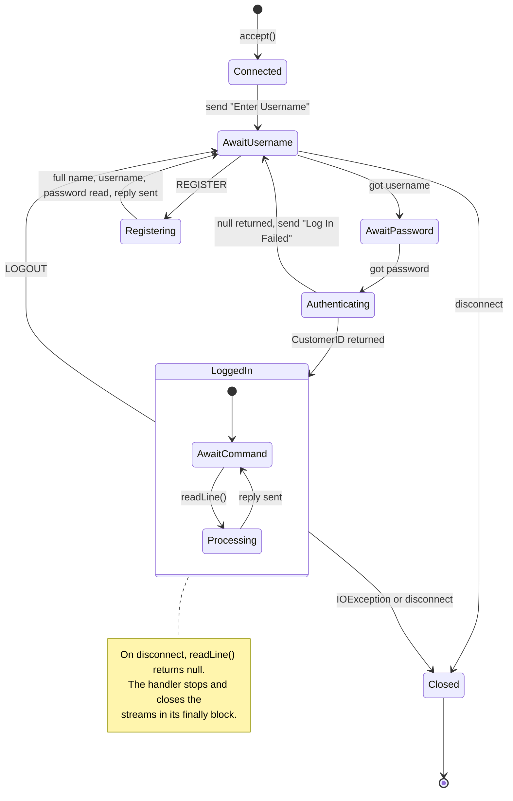
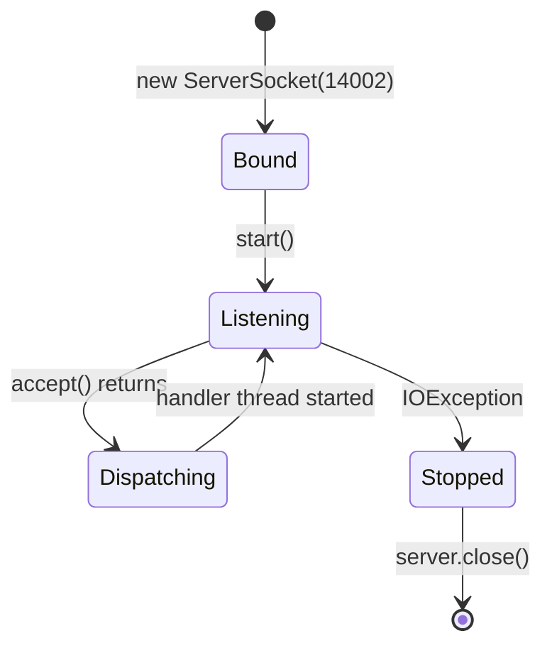
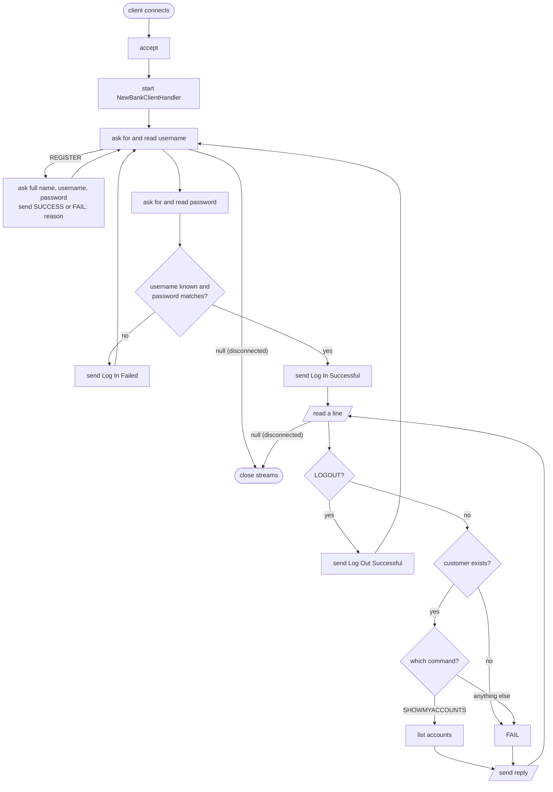
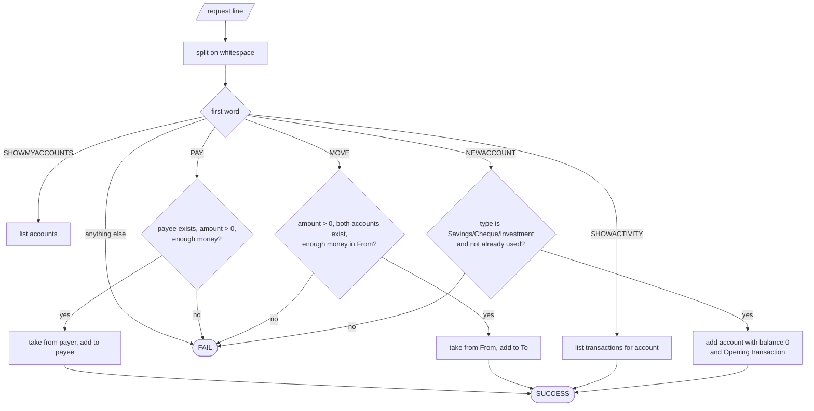
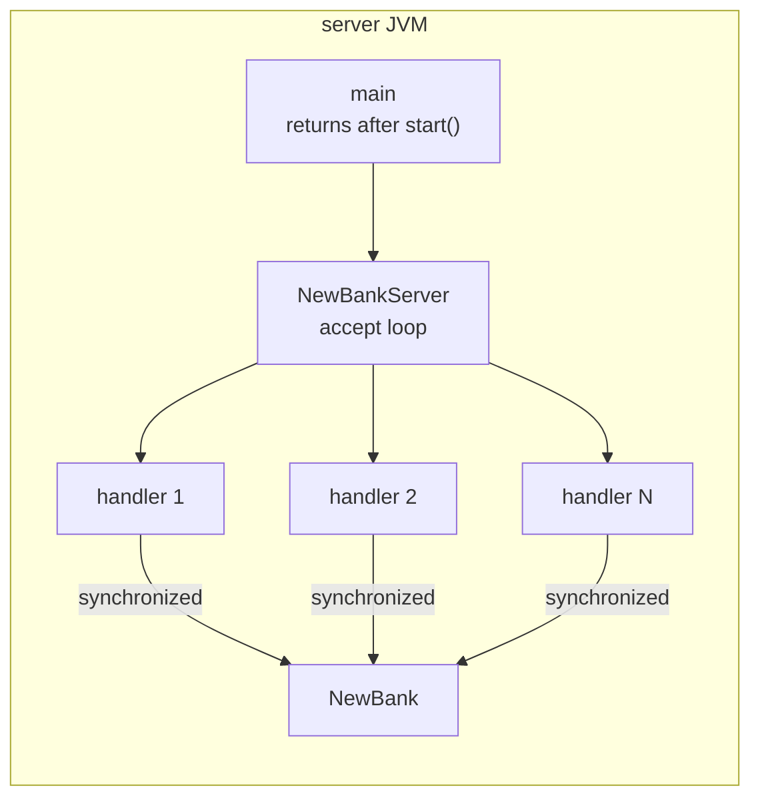

# NewBank

A small bank client and server written with plain Java sockets. The server listens on port 14002, gives each connection its own thread, asks for a username and password, then reads commands one line at a time.

The protocol in [protocol.txt](protocol.txt) lists the socket commands. `REGISTER`, `SHOWMYACCOUNTS`, `NEWACCOUNT` and `SHOWACTIVITY` are implemented.

## Contents

- [Layout](#layout)
- [Running it](#running-it)
- [Protocol](#protocol)
- [Architecture](#architecture)
- [Classes](#classes)
- [A session, step by step](#a-session-step-by-step)
- [States](#states)
- [Request handling](#request-handling)
- [Threads](#threads)

## Layout

```text
bath_new_bank/
├── pom.xml
├── protocol.txt
├── customers_database.txt   (created on first run, not in git)
├── src/
│   ├── main/java/newbank/
│   │   ├── client/ExampleClient.java
│   │   └── server/
│   │       ├── NewBankServer.java
│   │       ├── NewBankClientHandler.java
│   │       ├── NewBank.java
│   │       ├── CustomerDatabase.java
│   │       ├── Customer.java
│   │       ├── Account.java
│   │       ├── Transaction.java
│   │       └── CustomerID.java
│   └── test/java/newbank/server/
│       ├── NewBankTest.java
│       ├── CustomerDatabaseTest.java
│       ├── CustomerTest.java
│       └── AccountActivityTest.java
└── target/                  (generated by Maven, not in git)
```

| Class | What it does |
|---|---|
| `NewBankServer` | Opens `ServerSocket(14002)` and loops on `accept()`, starting a `NewBankClientHandler` for each connection. |
| `NewBankClientHandler` | Runs the register and login prompts, then reads requests in a loop and writes back the replies. |
| `NewBank` | Singleton holding all customers in a `HashMap<String, Customer>`. Handles registration, login and command dispatch; its public methods are `synchronized`. |
| `CustomerDatabase` | Saves customers to and loads them from `customers_database.txt`. |
| `Customer` | A unique number ID, a full name, a password and a list of `Account`s. Its only constructor takes all three, so there's no customer without an ID. |
| `Account` | An account name, a `double` balance (the field is called `openingBalance`), and a list of `Transaction`s. |
| `Transaction` | One account activity entry: amount, date and beneficiary. |
| `CustomerID` | Wraps the username. Handed out on login and passed with every request. |
| `ExampleClient` | Console client. The main thread sends what you type; a second thread prints whatever the server sends back. |

### Test data

`NewBank.addTestData()` holds these three customers. On the first run there's no `customers_database.txt` yet, so the server creates it from this test data. After that, customers are loaded from the file (see [Saved data](#saved-data)).

| ID | Username | Account | Balance |
|---|---|---|---|
| 1 | `Bhagy` | Savings | 1000.0 |
| 2 | `Christina` | Savings | 1500.0 |
| 3 | `John` | Cheque | 250.0 |

The test customers have no full name or password.

## Running it

The following tools must be installed:

- JDK 11
- Maven

## How to run tests

```bash
mvn clean verify
```

## How to run the code formatter

```bash
mvn spotless:apply
```

## How to run the main application

### Build the JAR

```bash
mvn clean package
```

`ERROR:` lines are printed, and they are expected. They come from tests that break things on purpose:
- `could not load customers ... is not valid` comes from a test that uses a damaged file.
- `could not save customers ... is a directory` comes from tests that replace the customers file with a directory, to check that failed saves are reported on every OS.

### Run the server

```bash
java -jar target/newbank-server.jar
```

### Run the client

```bash
java -jar target/newbank-client.jar
```

## Test Structure

| Test class             | What it checks                                                                                                                                                                          |
| ---------------------- | --------------------------------------------------------------------------------------------------------------------------------------------------------------------------------------- |
| `CustomerTest`         | Password checking, including blank passwords for test customers.                                                                                                                        |
| `CustomerDatabaseTest` | Save then load gives back the same customers; damaged files and failed saves throw an error.                                                                                            |
| `NewBankTest`          | Register (including every `FAIL` reason and passwords with spaces), login, unique IDs across restarts, a damaged file is never overwritten, and a failed save doesn't report `SUCCESS`. |

`NewBank` has package-private constructors so tests can use a temporary file and a fixed `Clock`. The server itself uses `customers_database.txt` and the system clock.

### Using it

A session looks like this (lines starting with `>` are typed by you):

```text
Enter Username
> Bhagy
Enter Password
>
Checking Details...
Log In Successful. What do you want to do?
> SHOWMYACCOUNTS
Savings: 1000.0
> NEWACCOUNT Cheque
SUCCESS
> NEWACCOUNT Investment
SUCCESS
> SHOWMYACCOUNTS
Savings: 1000.0, Cheque: 0.0, Investment: 0.0
> SHOWACTIVITY Savings
1000.0 | 2026-11-17 | Opening
```

`nc localhost 14002` works just as well as the example client.

### Registering

To create a new customer, type `REGISTER` on its own at the `Enter Username` prompt. The server then asks for each detail on its own line, so the full name and password can contain spaces. The new customer gets a unique number ID and no accounts yet, so `SHOWMYACCOUNTS` returns an empty line.

```text
Enter Username
> REGISTER
Enter Full Name
> Alice Smith
Enter Username
> asmith
Enter Password
> my secret
SUCCESS
Enter Username
> asmith
Enter Password
> my secret
Checking Details...
Log In Successful. What do you want to do?
```

If something is wrong, the reply says what, for example `FAIL: Username asmith is already taken` or `FAIL: Password cannot be empty`. [protocol.txt](protocol.txt) lists every reason.

Usernames can't contain spaces. Names, usernames and passwords can't contain commas, because commas separate the fields in the saved file. Registered customers are saved to `customers_database.txt`, so they are still there after the server restarts. `SUCCESS` is only sent once the save has worked.

The checks are in `NewBank.registerCustomer()`. The prompts are in `NewBankClientHandler.register()`.

### Logging in

The username must exist and the password must match the one given at `REGISTER`. The test customers have no password, so leave the password blank (just press Enter), as in the example above.

If the login fails, the server asks for the username again. There's no limit on attempts: a limit kept per connection doesn't add security, because a client can simply reconnect.

```text
Enter Username
> asmith
Enter Password
> wrong
Checking Details...
Log In Failed. Please try again.
Enter Username
```

The check is in `NewBank.checkLogInDetails()` and `Customer.checkPassword()`. The prompts are in `NewBankClientHandler.logIn()`.

If the client disconnects (closes the window or presses Ctrl+C), `readLine()` returns `null`. The handler stops and closes the connection, both before and after login.

### Logging out

Type `LOGOUT` once logged in. The server says goodbye and goes back to the login prompt, so you can log in as someone else, or `REGISTER`, without restarting the client:

```text
> LOGOUT
Log Out Successful. Goodbye Bhagy.
Enter Username
```

`LOGOUT` must be in capitals, like the other commands.

`LOGOUT` is handled in `NewBankClientHandler.run()` rather than `NewBank.processRequest()`, because it ends the connection's session rather than changing the customer's data. `run()` loops: call `logIn()`, process commands until `LOGOUT`, then call `logIn()` again.

### Saved data

Customers are stored in a plain text file, `customers_database.txt`, in the project folder. The file isn't part of the repository: it's listed in `.gitignore`, and each person's copy is created the first time they run the server. The server finds it by name in the folder it's started from, so start the server from the project folder as shown in [Running it](#running-it). If you start it from somewhere else, it creates a new file there instead.

When the server starts (when the first client connects, which is when `NewBank` is first created), it checks whether `customers_database.txt` exists:

- **If it exists,** the customers are loaded from it.
- **If it doesn't,** it is created and filled with the test data from `addTestData()`.

Other details:

- **When it's written:** after every successful `REGISTER` or `NEWACCOUNT`. The whole file is rewritten each time.
- **Format:** one customer per line, `id,username,full name,password,AccountName:balance[#txs];AccountName:balance[#txs]`.
  Optional transactions after `#` use `date~amount~beneficiary`, separated by `|`.

```text
1,Bhagy,,,Savings:1000.0#2026-11-17~1000.0~Opening
2,Christina,,,Savings:1500.0#2026-11-17~1500.0~Opening
3,John,,,Cheque:250.0#2026-11-17~250.0~Opening
4,asmith,Alice Smith,secret,
```

Test customers have no full name or password, so those fields are empty. A newly registered customer has no accounts, so the last field is empty. Line order isn't fixed, because a `HashMap` has no order.

**IDs:** each customer has a unique number ID. When the file is loaded, `NewBank` remembers the highest ID in it, and each new `REGISTER` gets the next number up. IDs are never reused, even after a restart. The `HashMap` is still keyed by username, because that's what customers log in with.

To go back to just the test data, stop the server and delete `customers_database.txt`. The next run recreates it from `addTestData()`.

The code is in the `CustomerDatabase` class (`save()` and `load()`). It only uses `java.io`, with no external libraries.

**When something goes wrong:**

- **The file can't be loaded** (it's damaged, or a line is missing a field or has a bad number). The server prints an error and starts with no customers, and saving is switched off. This stops the empty list in memory from overwriting the real file and losing everyone. `REGISTER` replies `FAIL: Customer data could not be loaded...`. Fix or remove the file and restart.
- **A save fails** (for example, the file is read-only). The new customer is removed again and `REGISTER` replies `FAIL: Your details could not be saved...`. This means a customer is never told they're registered when they'd be lost on the next restart.
- **Loading is all or nothing.** `load()` only returns the customers once every line has been read successfully, so the bank never runs with half of them.

## Protocol

Everything is plain text over TCP, one message per line. After the username and password lines, each command you send gets exactly one line back. Account lists are comma-separated and activity records are separated by semicolons, so multi-item replies still fit on one line. Commands must match exactly, including case, so `showmyaccounts` gets `FAIL`.

| Command | Example | Reply | Implemented |
|---|---|---|---|
| `REGISTER` | `REGISTER`, then answer the full name, username and password prompts | `SUCCESS`, or `FAIL: <reason>`. Typed at the `Enter Username` prompt, before login. | Yes |
| `LOGOUT` | `LOGOUT` | `Log Out Successful. Goodbye <Username>.` then `Enter Username` | Yes |
| `SHOWMYACCOUNTS` | `SHOWMYACCOUNTS` | One line of accounts and balances, e.g. `Savings: 1000.0, Cheque: 250.0` | Yes |
| `NEWACCOUNT <Type>` | `NEWACCOUNT Savings` | `SUCCESS`, or `FAIL: <reason>`. Opening balance is always 0. Types: Savings, Cheque, Investment. | Yes |
| `SHOWACTIVITY <AccountType>` | `SHOWACTIVITY Savings` | One line of transactions, e.g. `100.0 \| 2026-11-17 \| Bhagy; -20.0 \| 2026-11-18 \| Shop`, or `No transactions` / `FAIL: <reason>` | Yes |
| `MOVE <Amount> <From> <To>` | `MOVE 100 Main Savings` | `SUCCESS` or `FAIL` | No, always `FAIL` |
| `PAY <Person/Company> <Amount>` | `PAY John 100` | `SUCCESS` or `FAIL` | No, always `FAIL` |

## Architecture



Seen as layers, each class only talks to the one below it:



## Classes



## A session, step by step



## States

### A client session on the server



### The server process



## Request handling

### Current code



### Once all four commands exist

One way to handle the rest of the protocol:



## Threads



Each connection gets a new thread. There's no pool and no cap on connections.

The public methods on `NewBank` are `synchronized` on the same instance, so requests from different clients run one at a time. That keeps the data safe without any other locking, at the cost of throughput.

`NewBank` is created when the class loads (`private static final`), so there's no race in creating the singleton.
