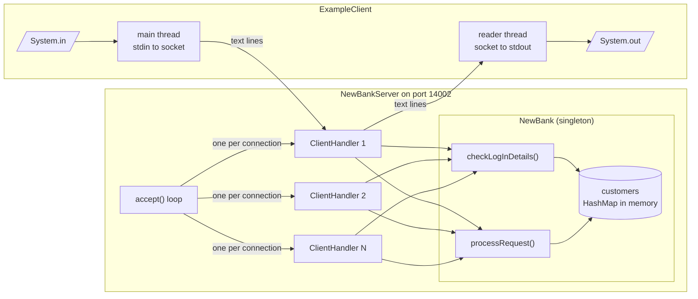
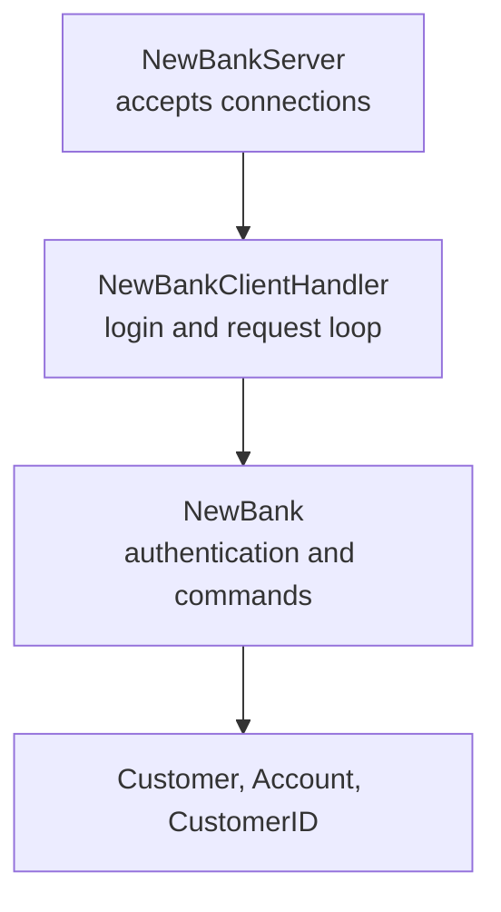
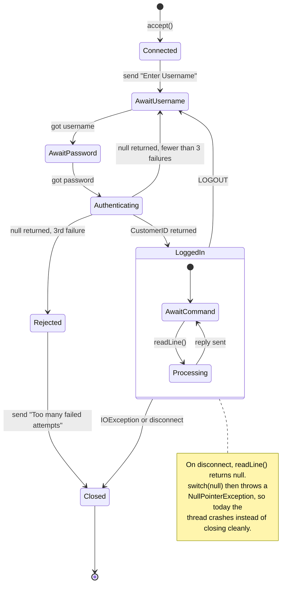
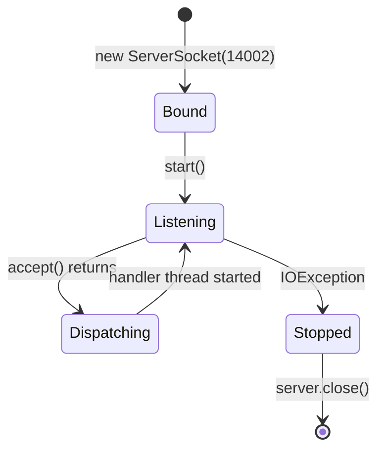
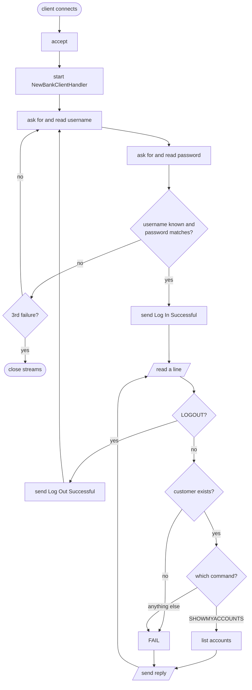
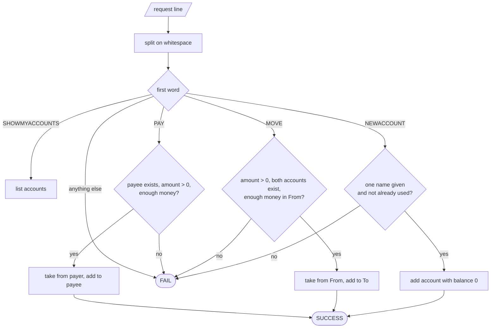
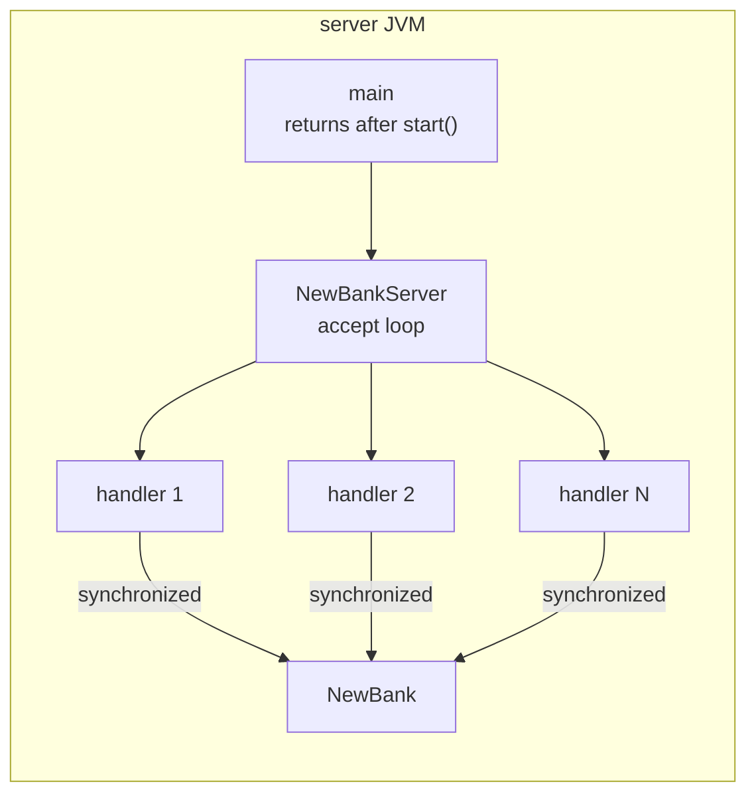

# NewBank

A small bank client and server written with plain Java sockets. The server listens on port 14002, gives each connection its own thread, asks for a username and password, then reads commands one line at a time.

The protocol in [protocol.txt](protocol.txt) lists five commands. `REGISTER` and `SHOWMYACCOUNTS` are implemented so far.

## Contents

- [Layout](#layout)
- [Running it](#running-it)
- [Protocol](#protocol)
- [Architecture](#architecture)
- [Classes](#classes)
- [A session, step by step](#a-session-step-by-step)
- [States](#states)
- [Request handling](#request-handling)
- [Threads](#threads)

## Layout

```text
bath_new_bank/
├── protocol.txt
├── customers_database.txt   (created on first run, not in git)
└── newbank/
    ├── client/
    │   └── ExampleClient.java
    └── server/
        ├── NewBankServer.java
        ├── NewBankClientHandler.java
        ├── NewBank.java
        ├── Customer.java
        ├── Account.java
        └── CustomerID.java
```

| Class | What it does |
|---|---|
| `NewBankServer` | Opens `ServerSocket(14002)` and loops on `accept()`, starting a `NewBankClientHandler` for each connection. |
| `NewBankClientHandler` | Runs the login prompts, then reads requests in a loop and writes back the replies. |
| `NewBank` | Singleton holding all customers in a `HashMap<String, Customer>`. Handles login and command dispatch; both methods are `synchronized`. |
| `Customer` | A unique number ID, a full name, a password and a list of `Account`s. |
| `Account` | An account name and a `double` balance (the field is called `openingBalance`). |
| `CustomerID` | Wraps the username. Handed out on login and passed with every request. |
| `ExampleClient` | Console client. The main thread sends what you type; a second thread prints whatever the server sends back. |

### Test data

`NewBank.addTestData()` holds these three customers. On the first run there's no `customers_database.txt` yet, so the server creates it from this test data. After that, customers are loaded from the file (see [Saved data](#saved-data)).

| ID | Username | Account | Balance |
|---|---|---|---|
| 1 | `Bhagy` | Main | 1000.0 |
| 2 | `Christina` | Savings | 1500.0 |
| 3 | `John` | Checking | 250.0 |

The test customers have no full name or password.

## Running it

You need JDK 8 or later. There are no dependencies and no build tool.

```bash
javac -d out newbank/server/*.java newbank/client/*.java

# terminal 1
java -cp out newbank.server.NewBankServer

# terminal 2
java -cp out newbank.client.ExampleClient
```

A session looks like this (lines starting with `>` are typed by you):

```text
Enter Username
> Bhagy
Enter Password
>
Checking Details...
Log In Successful. What do you want to do?
> SHOWMYACCOUNTS
Main: 1000.0
> NEWACCOUNT Savings
FAIL
```

`nc localhost 14002` works just as well as the example client.

### Logging in

The username must exist and the password must match the one given at `REGISTER`. The test customers have no password, so leave the password blank (just press Enter), as in the example above.

You get 3 attempts. After a failed attempt, the server says how many are left and asks for the username again. After the third failure, it disconnects:

```text
Enter Username
> asmith
Enter Password
> wrong
Checking Details...
Log In Failed. Attempts left: 2
Enter Username
```

Typing `REGISTER ...` at the username prompt doesn't use up an attempt.

The check is in `NewBank.checkLogInDetails()` and `Customer.checkPassword()`. The attempt counting is in `NewBankClientHandler.logIn()`.

### Logging out

Type `LOGOUT` once logged in. The server says goodbye and goes back to the login prompt, so you can log in as someone else, or `REGISTER`, without restarting the client:

```text
> LOGOUT
Log Out Successful. Goodbye Bhagy.
Enter Username
```

Each new login starts with 3 fresh attempts. `LOGOUT` must be in capitals, like the other commands.

`LOGOUT` is handled in `NewBankClientHandler.run()` rather than `NewBank.processRequest()`, because it ends the connection's session rather than changing the customer's data. `run()` loops: call `logIn()`, process commands until `LOGOUT`, then call `logIn()` again.

To create a new customer, type `REGISTER <Full Name> <Username> <Password>` at the `Enter Username` prompt. The full name can be several words, and the last two words are always the username and password. The new customer gets a unique number ID and no accounts yet, so `SHOWMYACCOUNTS` returns an empty line.

```text
Enter Username
> REGISTER Alice Smith asmith secret
SUCCESS
Enter Username
> asmith
Enter Password
> secret
Checking Details...
Log In Successful. What do you want to do?
```

Registered customers are saved to `customers_database.txt`, so they are still there after the server restarts. Names, usernames and passwords can't contain commas, because commas separate the fields in that file.

### Saved data

Customers are stored in a plain text file, `customers_database.txt`, in the project folder. The file isn't part of the repository: it's listed in `.gitignore`, and each person's copy is created the first time they run the server. The server finds it by name in the folder it's started from, so start the server from the project folder as shown in [Running it](#running-it). If you start it from somewhere else, it creates a new file there instead.

When the server starts (when the first client connects, which is when `NewBank` is first created), it checks whether `customers_database.txt` exists:

- **If it exists,** the customers are loaded from it.
- **If it doesn't,** it is created and filled with the test data from `addTestData()`.

Other details:

- **When it's written:** after every successful `REGISTER`. The whole file is rewritten each time.
- **When it's written:** after every successful `REGISTER`. The whole file is rewritten each time.
- **Format:** one customer per line, `id,username,full name,password,AccountName:balance;AccountName:balance`.

```text
1,Bhagy,,,Main:1000.0
2,Christina,,,Savings:1500.0
3,John,,,Checking:250.0
4,asmith,Alice Smith,secret,
```

Test customers have no full name or password, so those fields are empty. A newly registered customer has no accounts, so the last field is empty. Line order isn't fixed, because a `HashMap` has no order.

**IDs:** each customer has a unique number ID. When the file is loaded, `NewBank` remembers the highest ID in it, and each new `REGISTER` gets the next number up. IDs are never reused, even after a restart. The `HashMap` is still keyed by username, because that's what customers log in with.

To go back to just the test data, stop the server and delete `customers_database.txt`. The next run recreates it from `addTestData()`.

The code is in `NewBank.saveCustomers()` and `NewBank.loadCustomers()`. It only uses `java.io`, with no external libraries.

## Protocol

Everything is plain text over TCP, one message per line. After the username and password lines, each command you send gets exactly one line back. Commands must match exactly, including case, so `showmyaccounts` gets `FAIL`.

| Command | Example | Reply | Implemented |
|---|---|---|---|
| `REGISTER <Full Name> <Username> <Password>` | `REGISTER Alice Smith asmith secret` | `SUCCESS`, or `FAIL` if the format is wrong, the username is taken, or anything contains a comma. Typed at the `Enter Username` prompt, before login. | Yes |
| `LOGOUT` | `LOGOUT` | `Log Out Successful. Goodbye <Username>.` then `Enter Username` | Yes |
| `SHOWMYACCOUNTS` | `SHOWMYACCOUNTS` | Accounts and balances, e.g. `Main: 1000.0` | Yes |
| `NEWACCOUNT <Name>` | `NEWACCOUNT Savings` | `SUCCESS` or `FAIL` | No, always `FAIL` |
| `MOVE <Amount> <From> <To>` | `MOVE 100 Main Savings` | `SUCCESS` or `FAIL` | No, always `FAIL` |
| `PAY <Person/Company> <Amount>` | `PAY John 100` | `SUCCESS` or `FAIL` | No, always `FAIL` |

## Architecture



Seen as layers, each class only talks to the one below it:



## Classes

```mermaid
classDiagram
    direction LR

    class NewBankServer {
        -ServerSocket server
        +NewBankServer(int port)
        +run()
        +main(String[] args)$
    }
    class NewBankClientHandler {
        -NewBank bank
        -BufferedReader in
        -PrintWriter out
        +NewBankClientHandler(Socket s)
        -logIn() CustomerID
        +run()
    }
    class NewBank {
        -NewBank bank$
        -HashMap~String,Customer~ customers
        -NewBank()
        -addTestData()
        +getBank()$ NewBank
        +checkLogInDetails(String userName, String password) CustomerID
        +processRequest(CustomerID customer, String request) String
        -showMyAccounts(CustomerID customer) String
    }
    class Customer {
        -ArrayList~Account~ accounts
        +accountsToString() String
        +addAccount(Account account)
    }
    class Account {
        -String accountName
        -double openingBalance
        +toString() String
    }
    class CustomerID {
        -String key
        +getKey() String
    }
    class ExampleClient {
        -Socket server
        -PrintWriter bankServerOut
        -BufferedReader userInput
        -Thread bankServerResponceThread
        +run()
        +main(String[] args)$
    }

    Thread <|-- NewBankServer
    Thread <|-- NewBankClientHandler
    Thread <|-- ExampleClient
    NewBankServer ..> NewBankClientHandler : creates per connection
    NewBankClientHandler --> NewBank : uses singleton
    NewBankClientHandler ..> CustomerID : holds after login
    NewBank "1" o-- "*" Customer : customers (key = userName)
    Customer "1" o-- "*" Account : accounts
    NewBank ..> CustomerID : issues
    ExampleClient ..> NewBankServer : TCP port 14002
```



## A session, step by step

```mermaid
sequenceDiagram
    autonumber
    actor U as User
    participant C as ExampleClient
    participant S as NewBankServer
    participant H as NewBankClientHandler
    participant B as NewBank

    C->>S: connect to localhost:14002
    S->>H: start handler thread
    H-->>C: "Enter Username"
    U->>C: Bhagy
    C->>H: "Bhagy"
    H-->>C: "Enter Password"
    U->>C: ****
    C->>H: "****"
    H-->>C: "Checking Details..."
    H->>B: checkLogInDetails(user, pwd)
    alt username exists and password matches
        B-->>H: CustomerID("Bhagy")
        H-->>C: "Log In Successful. What do you want to do?"
        loop every line the user sends
            U->>C: SHOWMYACCOUNTS
            C->>H: "SHOWMYACCOUNTS"
            H->>B: processRequest(id, request)
            B-->>H: "Main: 1000.0"
            H-->>C: "Main: 1000.0"
        end
        U->>C: LOGOUT
        C->>H: "LOGOUT"
        H-->>C: "Log Out Successful. Goodbye Bhagy."
        H-->>C: "Enter Username"
    else unknown username or wrong password
        B-->>H: null
        H-->>C: "Log In Failed. Attempts left: n"
        Note over C,H: back to "Enter Username"; after 3 failures<br/>the handler disconnects
    end
```

## States

### A client session on the server



### The server process



## Request handling

### Current code



### Once all four commands exist

One way to handle the rest of the protocol:



## Threads



Each connection gets a new thread. There's no pool and no cap on connections.

Both public methods on `NewBank` are `synchronized` on the same instance, so requests from different clients run one at a time. That keeps the data safe without any other locking, at the cost of throughput.

`NewBank` is created when the class loads (`private static final`), so there's no race in creating the singleton.
